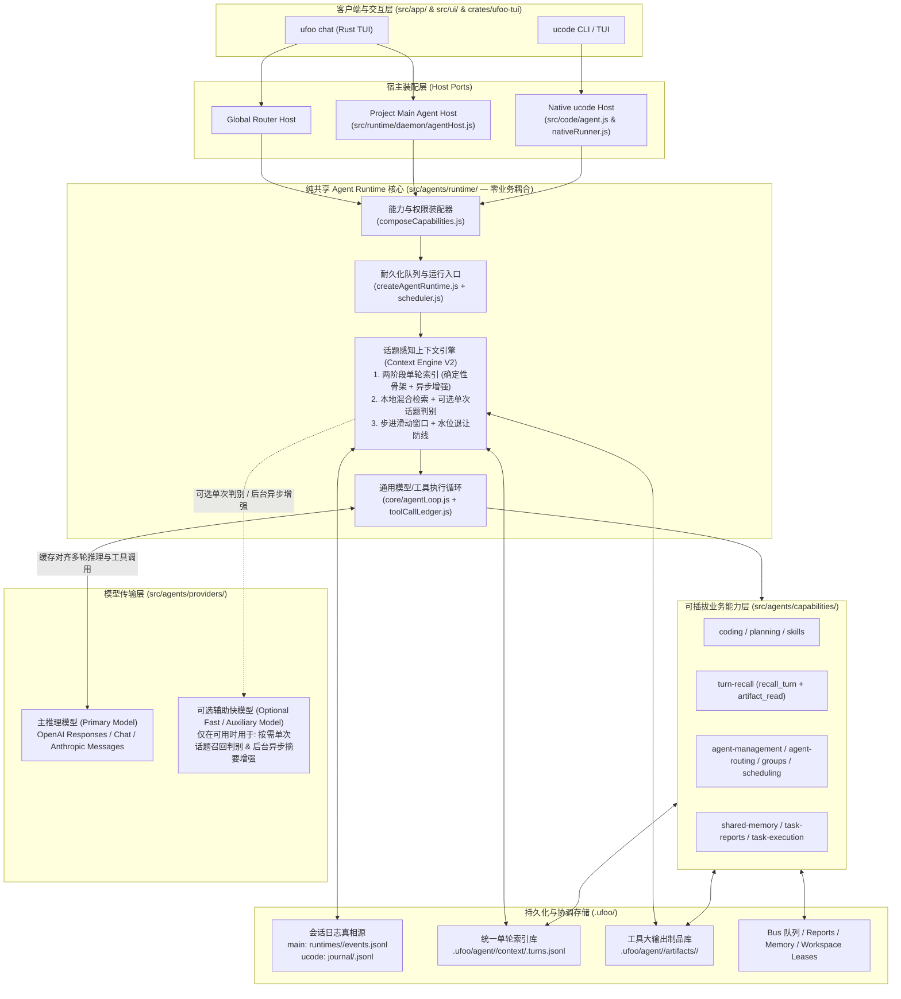
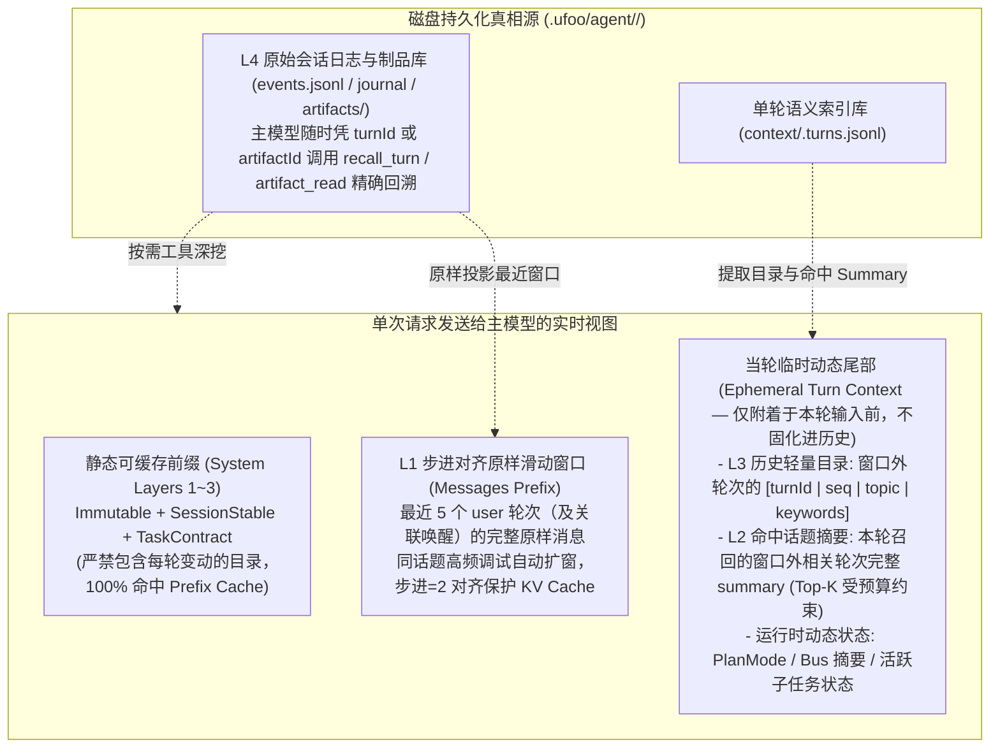
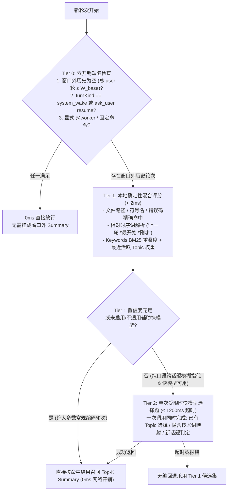
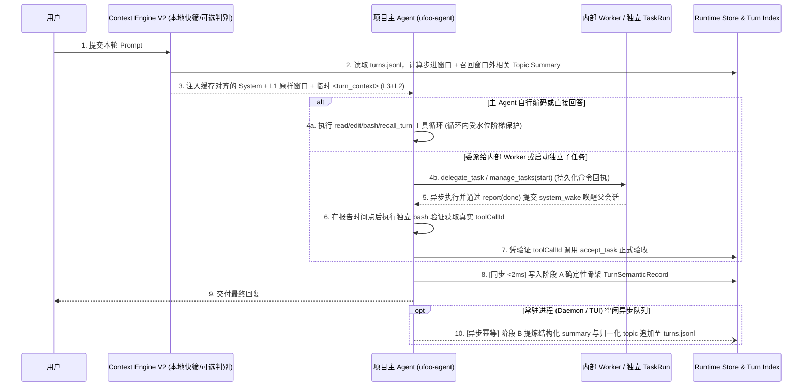

# ufoo Agent Runtime 完整架构设计方案（V2 修订版）

## 1. 架构愿景与核心设计原则

`ufoo` 是一个多 Agent 协同工作区运行时（Multi-Agent Workspace Runtime）。一个用户级全局守护进程（Global Daemon）托管多个隔离的项目运行时（Project Runtime），统一承载主对话面板、事件总线（Event Bus）、持久化记忆、任务报告、群组编排（Groups）、定时调度（Cron）以及跨 Agent 工具路由。

本方案将 **现有的分层可插拔执行核心** 与 **“单轮单次索引（永不滚雪球二次压缩）+ 缓存对齐的弹性滑动窗口 + 混合检索与可选轻判别”上下文引擎（Context Engine V2）** 融合为一套严守模块边界、适配真实传输协议的 Agent Runtime 架构规范。

### 1.1 产品形态与角色矩阵

| 运行角色 | 入口 / 宿主 | 适用 Profile | 上下文管理归属与核心职责 |
| :--- | :--- | :--- | :--- |
| **项目主 Agent (`ufoo-agent`)** | [src/runtime/daemon/agentHost.js](src/runtime/daemon/agentHost.js) | `main` | **使用共享 Runtime + Context Engine V2**。项目级总控与主对话入口，具备直接编码、计划拆解、独立子任务管理、内部 Worker 启动/委派/验收、群组与定时服务能力。 |
| **全局路由 Agent (`global-router`)** | [src/runtime/daemon/agentHost.js](src/runtime/daemon/agentHost.js) | `global-router` | **使用共享 Runtime（轻量只读窗口）**。负责跨项目检索、回答全局状态问题、并将具体任务持久化转交至目标项目的 `ProjectRuntime`。 |
| **原生编码 Agent (`ucode`)** | `bin/ucode.js` / [src/code/internalThread.js](src/code/internalThread.js) | `coding` | **使用共享 Runtime + Context Engine V2**。独立 CLI/TUI 或内嵌 Headless 编码线程，与主 Agent 共用底层循环、工具账本与单轮索引上下文引擎。 |
| **独立编码子任务 (`main-task`)** | [src/runtime/daemon/agentHost.js](src/runtime/daemon/agentHost.js) (`getChild`) | `coding-task` / `coding-read-only` | **使用共享 Runtime（单任务独立窗口）**。主 Agent 派生的隔离执行上下文（支持验证过的 `git worktree` 并行或主目录写锁串行），完成后仅向父会话汇报摘要与证据。 |
| **内部 SDK Worker (`codex` / `claude`)** | [src/agents/internal/internalRunner.js](src/agents/internal/internalRunner.js) | 官方 SDK 线程 | **保持各自官方 SDK 托管会话上下文**。与 `ucode` 共享统一状态面板、收件箱索赔（Inbox Claim）与报告契约；其外部任务画像由协调层从任务账本与 Report Store 派生。 |
| **外部包装器/MCP Agent** | `uclaude` / `ucodex` / `uagy` / `ugrok` / `ukimi` / MCP | 外部宿主 | 通过环境变量 `UFOO_SUBSCRIBER_ID`（包装器直注）或 MCP `register_agent` + `wait_for_message` 接入总线协作。 |

### 1.2 核心设计铁律

1. **客户端与状态分离**：Chat/TUI 只是纯视图客户端；Daemon 拥有全部运行时状态，断开 UI 连接绝不隐式取消后台任务。
2. **追加日志为唯一真相源（Append-Only Truth）**：所有会话状态、工具账本、命令回执与单轮语义索引均通过追加式 JSONL（配合 `fsync`、`0600` 权限、尾部半行截断恢复与同步文件锁）持久化；内存快照与上下文视图均为可重建投影。
3. **永不滚雪球二次压缩（Write-Once Turn Indexing, Zero Generational Loss）**：
   * 彻底摒弃传统的 `previousSummary + batch` 反复合并式压缩（避免多代摘要丢失文件路径、符号名与 `artifactId`）。
   * 采用 **“两阶段单轮索引（终态毫秒级确定性骨架同步落盘 + 后台可选异步语义增强）+ 弹性原样滑动窗口 + 按话题动态挂载历史 Summary + 按 ID 原文深挖”**。
4. **缓存前缀绝对稳定、动态上下文严格后置（Cache-First Prefix, Ephemeral Tail）**：
   * `System` 前缀层严禁放入任何每轮变化的目录或动态列表，严守 Anthropic 最多 `4` 个 `cache_control` 断点的协议硬限制；
   * 滑动窗口左边界采用步进对齐（Step Alignment），每轮动态变化的 `L3 历史目录 + L2 命中话题 Summary` 仅作为**当轮临时尾部上下文（Ephemeral Turn Context）**注入，绝不固化进历史消息流，最大化跨轮与单轮多步工具调用的 KV Cache 命中率。
5. **确定性快筛优先、轻判别按需单次触发、硬性水位兜底**：
   * 短会话、系统唤醒、显式 `@worker` 零延迟直通（`0ms`）；
   * 存在窗口外历史时，优先通过本地词面/路径/符号/BM25 毫秒级召回；仅当存在指代歧义且配置了可用快模型时触发**至多一次**带短超时的判别调用（只做客观摘要检索，绝不篡改或重写用户原意）；
   * 在 `agentLoop` 每一轮模型调用前保留确定性 Token 水位退让防线，无需同步等待模型总结即可化解单轮超长工具链溢出。
6. **核心零业务耦合与副作用安全**：
   * 严守 [AGENTS.md](AGENTS.md) 边界：`src/agents/runtime/` 绝不导入 `coding`、`daemon`、UI 或多 Agent 路由实现；
   * 未知副作用（`uncertain`）绝不盲目自动重放；子任务/Worker 声称完成（`done`）后，主 Agent 必须在完成时间点之后执行独立 `bash` 校验并凭真实 `toolCallId` 验收。

---

## 2. 整体分层架构与模块边界图



---

## 3. 第一层：可插拔 Runtime 执行核心 (`src/agents/runtime/`)

### 3.1 声明式组装与耐久化接口

Runtime 核心不含任何具体业务工具名（如 `bash`、`plan_graph`、`delegate_task`）或硬编码的 Agent 类型分支，一切通过 [src/agents/runtime/createAgentRuntime.js](src/agents/runtime/createAgentRuntime.js) 注入：

| 核心公开 API | 行为契约 |
| :--- | :--- |
| `submit({ requestId, text, attachments?, taskId?, resourceKey?, requestMeta? })` | 同步在 `runtimeStore` 中持久化 `request.accepted` 并排入内部 `pump()` 队列。相同 `requestId` 且内容指纹一致时幂等复用同一 `TaskRun`；内容不同则报 `request_conflict`。 |
| `resume({ interactionId, answer })` | 校验并恢复处于 `waiting_user`（如 `ask_user` 暂停）的任务，将用户回答物化为对应 `toolCallId` 的 `tool_result` 后继续同一逻辑轮次。 |
| `cancel({ taskRunId, reason? })` | 排队或暂停任务直接写入 `task.cancelled` 终态；运行中任务写入 `task.cancel_requested` 并触发 `AbortController`。状态查询与取消绝不排在长耗时工具之后。 |
| `wait(taskRunId)` | 异步等待指定 `taskRunId` 进入终态（`completed` / `failed` / `cancelled` / `interrupted` / `waiting_user`）。 |
| `snapshot()` / `events({ after? })` | 读取当前会话的重建状态投影或增量事件流（公共 IPC 经 `redactSecrets` 进一步脱敏凭据与工具大输出）。 |
| `run(input)` | 单次模型/工具闭环运行入口（供 `pump()` 内部调度及独立 `ucode` 直接调用），严格禁止同一实例并发重叠运行，并在终态统一触发单轮确定性索引落盘钩子 `onTurnSettled`。 |
| `close()` | 触发运行中任务的 `AbortSignal`，取消未决的后台摘要增强请求，按注册逆序调用各 Capability 的 `dispose()`，释放当前 PID 的 Session Owner 租约。 |

### 3.2 Capability 插件契约与权限裁定

每个业务模块通过标准 Capability 对象接入（见 [src/agents/runtime/composeCapabilities.js](src/agents/runtime/composeCapabilities.js)）：

* **静态声明**：`id`、`version`、`requires`（依赖的其他能力、Host Ports、Provider 特性如 `vision`/`tool_calls`）、`requestedPermissions`。
* **权限裁定（Host Authoritative）**：Profile 仅声明需要哪些能力，具体工具能否暴露给模型并被执行，取决于 `host.grantedPermissions` 与 Caller Tier（`CONTROLLER` vs `WORKER`）的交集。
* **扩展钩子**：`tools`、`promptSections`、`contextSources`、`reduce(state, event)`、`handleEvent(event)` 与 `policies`（`initializeState`、`beforeTurn`、`prepareTurn`、`validateBatch`、`beforeTool`、`validateTool`、`afterTool`、`continueAfterFinal`、`pendingInteraction`）。

### 3.3 通用模型/工具循环 (`agentLoop.js`) 与协议账本

在单次执行尝试（`TaskRun` / `run()`）内部，[src/agents/runtime/core/agentLoop.js](src/agents/runtime/core/agentLoop.js) 驱动多步模型与工具交互：

1. **协议配对账本（[src/agents/runtime/protocol/toolCallLedger.js](src/agents/runtime/protocol/toolCallLedger.js)）**：
   * 模型产出的每个工具调用先分配唯一 `callId` 并进入 `declared` $\rightarrow$ `executing` 状态，全部决议后统一经 `materializeResolvedToolResults` 成对写入消息流，彻底杜绝孤儿 `tool_use` / `tool_result`。
   * Anthropic 带签名的 `thinking` 块（含 `signature`）在单轮工具续写期间严格原样保留，绝不篡改。
2. **增量会话提交（`onConversationUpdate`）**：
   * 每个完整的“模型推理 + 工具结果配对”批次完成后，立即 `await commitConversation()` 落盘。后续网络中断、取消或超预算不会丢失已完成的前序工具批次。
3. **工具结果制品化（Artifact Reduction）**：
   * 编码与 Shell 工具大输出自动剥离 Base64 并持久化至 `.ufoo/agent/<ns>/artifacts/<sessionId>/`（[src/code/context/artifacts.js](src/code/context/artifacts.js)），进入模型消息流的仅是 `{ artifactId, preview, summary }`。
4. **死循环守卫与执行预算**：
   * `ToolLoopGuard` 拦截重复参数死循环；共享预算（[src/agents/runtime/core/executionBudget.js](src/agents/runtime/core/executionBudget.js)）默认不限模型轮次、工具错误上限 `20` 次、总超时 `12` 小时。

---

## 4. 第二层：主推理模型与可选辅助快模型策略

吸取 [AGENT_RUNTIME_REFACTOR.md](AGENT_RUNTIME_REFACTOR.md) 统一模型配置的经验，新架构**不强制要求用户配置两套模型与凭据**，而是将辅助快模型定义为**渐进增强的可选加速层**：

| 模型角色 | 配置来源 | 职责范围 | 降级与安全约束 |
| :--- | :--- | :--- | :--- |
| **主推理模型 (`Primary Model`)** | 现有 `agentProvider` / `agentModel`（`ucode` 使用 `ucode*` 独立配置） | 负责主对话回复、代码实现、工具调用、最终意图理解与委派决策。 | 唯一必需模型。保留现有 Provider 凭据隔离与会话绑定语义。 |
| **可选辅助模型 (`Auxiliary / Fast Model`)** | 可选高级项：`auxModel`（复用当前 Provider 凭据；自定义网关绝不盲猜未授权的模型 ID） | 1. **后台异步增强**：回合结束后提炼高密度 `summary` 与归一化 `topic`<br/>2. **按需单次召回判别**：仅当存在窗口外历史且本地检索置信度不足时，辅助筛选 `matchedTopics` / `referencedTurnIds` | **完全可缺省**：<br/>- 未配置、单次 CLI 即将退出、或使用强制深度思考模型（如 `claude-opus-5-5`）时，**前置判别直接走本地混合检索（0ms）**；<br/>- 后台摘要在常驻进程（Daemon / TUI）中可用主模型 `thinkingLevel: "low"` 空闲异步生成，失败则保留确定性骨架索引。 |

---

## 5. 第三层：Context Engine V2（单轮索引 + 步进滑动窗口 + 缓存对齐投影）

本层统一替代原有的滚雪球检查点压缩器（`compaction.js` / `checkpointStore.js`）以及 `ucode` 中重叠的滚动摘要逻辑（[src/code/context/assembler.js](src/code/context/assembler.js) 中的 `buildRollingSummary`），同时服务于 `ufoo` 主 Agent 与 `ucode`。

### 5.1 核心概念：“逻辑轮次（Logical Turn）”与轮次分类

#### 1. 原子边界与轮次类型（`turnKind`）
在 `ufoo` 中，一次 `submit()` 或 `run()` 闭环构成一个 **Logical Turn**（包含输入、内部 $0 \sim N$ 步工具调用及终态结果），但并非每次触发都来自真人输入（参考 [src/runtime/daemon/agentHost.js](src/runtime/daemon/agentHost.js) 的 `requestKind`）：

| `turnKind` | 触发来源 | 滑动窗口配额规则 | 前置话题判别 |
| :--- | :--- | :--- | :--- |
| `user` | 用户真实发起的 Prompt（含 `ask_user` 恢复后的延续闭环） | **计入基准用户轮次配额**（默认保留最近 $W_{\text{base}} = 5$ 个 `user` 轮次） | 按需触发（仅当存在窗口外历史轮次时） |
| `system_wake` | Worker 进展/完成报告唤醒（`worker-report`）、独立子任务完成唤醒（`task-result`）、定时任务（`cron`） | **挂载于所属父目标周期内，不挤占 `user` 轮次计数**；受总 Token 水位约束，水位紧张时优先折叠中间态 `progress` 唤醒 | **直接跳过（0ms）**，自动继承关联父任务的 Topic |

* **全终态覆盖**：无论轮次以 `completed`、`failed`、`cancelled` 还是 `interrupted` 结束（只要产生了对话或工具副作用），均分配递增 `seq` 并建立索引，彻底避免因中途取消或报错导致主模型遗忘已落盘的文件改动。
* **`ask_user` 暂停与恢复**：`waiting_user` 暂停时不切分新轮次；待 `resume()` 完成后作为同一个 `turnId` 落盘完整闭环。

#### 2. 四级上下文存储与寻址模型



---

### 5.2 两阶段单轮索引器（毫秒级确定性骨架 + 后台可选异步增强）

为同时满足 **CLI 单次命令秒退零丢失**（如 `ucode "修复测试"` 结束即退出进程）与 **长会话高质量语义检索**，索引落盘分为两个幂等阶段，统一追加写入 `.ufoo/agent/<ns>/context/<sessionId>.turns.jsonl`（按 `turnId` 聚合最新记录）：

#### 阶段 A：终态同步确定性骨架（`< 2ms`，零网络依赖，100% 必达）
在每一轮进入终态（`completed / failed / cancelled / interrupted`）时，同步提取客观元数据立即 `fsync` 落盘：
* **精确代码足迹**：从本轮工具调用中确定性提取 `touchedFiles`（读/改/写路径）、`modifiedFiles`、执行的命令摘要、`artifactIds`、错误码及 `@worker` 引用；
* **初始关键词与话题**：提取路径文件名、核心标识符与 Prompt 首行关键词作为初始 `keywords`，默认延续当前活跃 Topic（首轮则取 Prompt 摘要词）。
* **即时可用**：即使离线、无快模型、或 CLI 进程下一毫秒退出，该轮记录已完整在册，可供后续 `recall_turn` 与本地 BM25 检索。

#### 阶段 B：后台异步语义增强（仅常驻进程 Daemon / TUI 空闲执行，幂等覆盖）
在 Daemon 或交互式 TUI 中，回合返回后向后台低优先级队列投递单轮提炼任务，结合当前会话已有的 `Topic Set` 输出 `status: "enriched"` 记录：

```json
{
  "indexVersion": 2,
  "status": "enriched",
  "turnId": "task_8f91c2a0",
  "seq": 6,
  "turnKind": "user",
  "outcome": "completed",
  "createdAt": "2026-11-15T15:30:00.000Z",
  "topic": "Rust TUI 鼠标选中与剪贴板",
  "isNewTopic": false,
  "keywords": ["ufoo-tui", "selection.rs", "clipboard.rs", "OSC52", "pbcopy"],
  "modifiedFiles": ["crates/ufoo-tui/src/selection.rs", "crates/ufoo-tui/src/clipboard.rs"],
  "artifactIds": ["art_0192a", "art_0192b"],
  "summary": "修复 macOS 下分栏拖拽选中未写入系统剪贴板的问题：修改 selection.rs 排除边框字符，调整 clipboard.rs 中 pbcopy 触发条件（制品: art_0192a, art_0192b），cargo test -p ufoo-tui 70 项测试通过。",
  "promptHead": "macOS 下拖拽选中右侧 pane 的文字没有复制进剪贴板，帮我排查修复",
  "assistantTail": "已完成修改并通过全部 70 个 Rust TUI 测试。"
}
```

**防退化与安全约束**：
* **话题收敛（Topic Normalization）**：Prompt 强制优先复用已有 `Topic Set` 中的话题名；仅当确属新领域时创建新 `topic`，防止同义词碎片化。
* **不自动提取永久全局约束**：取消原先易把临时调试指令（如“这轮先别跑测试”）永久锁死的 `pinnedConstraints` 自动提取；跨周期长期规则继续通过显式的 `.ufoo/memory/` 工具或 `AGENTS.md` 管理。
* **防指令注入**：历史消息作为纯数据喂给提炼器（`tools: []`），落盘前统一经过 `redactSecrets` 脱敏。

---

### 5.3 回合前置：三级渐进式话题召回器 (`topicSelector.js`)

摒弃“每轮必调快模型 + 两阶段串行调用 + 重写用户意图”的高延迟高风险做法，采用 **三级渐进式召回（Tiered Topic Selection）**：



**关键设计改进**：
1. **单次调用取代串行两阶段**：当进入 Tier 2 时，候选集 `[0] __NEW_TOPIC__`、已有 `Topic Set (含聚合 keywords)`、最近 5 轮精简骨架与本轮 Prompt 在**一次请求**中同时完成“直接匹配 + 现象词到历史关键词映射”，绝不串行发起第二次前置 LLM 请求。
2. **只做“客观检索召回”，不做“主观意图改写”**：输出契约仅包含 `{ isNewTopic, matchedTopics, referencedTurnIds }`，用于从 `turns.jsonl` 中把对应历史轮次的客观 `summary` 挂载到 `L2`，**不再向主模型注入小模型主观脑补的 `resolvedIntent`**，彻底消除小模型看错指代（如把“改上面那个代码块”误判为历史旧话题）带偏主模型的风险。

---

### 5.4 步进对齐滑动窗口与硬性 Token 水位防线 (`slidingWindowManager.js`)

为了在 **保留长上下文原样细节**、**极高 KV Cache 命中率** 与 **绝不触发 Context Overflow 崩溃** 之间取得严格平衡，`slidingWindowManager` 实现与现有 [src/agents/runtime/core/agentLoop.js](src/agents/runtime/core/agentLoop.js) 完全兼容的 `contextManager.prepare(input)` 接口：

#### 1. 步进对齐弹性原样窗口（Step-Aligned Adaptive Window）
* **基础配额**：以 `user` 轮次计数，基准保留最近 $W_{\text{base}} = 5$ 个 `user` 轮次及其间关联的 `system_wake` 轮次。
* **疑难同话题扩窗**：若最近 5 个 `user` 轮次中同一主导话题 $Topic_{\text{hot}}$ 占比 $\ge 3$ 轮，向前连续吸纳属于 $Topic_{\text{hot}}$ 的历史轮次（最多允许跳过 1 轮简短穿插），上限 $W_{\text{max}} = 10$ 轮且不超过窗口 Token 软预算（默认上下文可用上限的 `45%`）。
* **KV Cache 步进对齐（Step = 2）**：窗口左边界 `windowStartSeq` 持久化在会话运行态中。当新增轮次未突破软水位且距离上次左移不足 `2` 个 `user` 轮次时，保持 `windowStartSeq` 不动（即允许窗口自然增长 1 轮再一次性右移 2 轮），保证连续多轮请求的历史消息前缀字节级一致。

#### 2. 单轮循环内硬性 Token 水位退让阶梯（Deterministic Eviction Ladder）
`agentLoop.js` 在单轮内部的**每一次工具调用后、下一次模型请求前**都会调用 `prepare()`。设模型窗口上限为 $L$，保留输出预算 $R$，硬上限 $B_{\text{hard}} = L - R$，软目标水位 $B_{\text{target}} = 0.80 \times B_{\text{hard}}$。当预估占用（经上轮真实 `usage` 比例校准）超过 $B_{\text{target}}$ 或捕获 `isContextOverflow`（`force = true`）时，按以下**纯确定性阶梯（0ms，无需调用模型压缩）**逐级释放空间：

1. **Level 1（收紧尾部动态预算）**：
   * `L2 命中话题 Summary` 严格按相关性截断至最多 `Top-8` 轮（上限 `3,500` Tokens）；
   * `L3 历史目录` 若超过 `80` 轮（上限 `2,500` Tokens），将更早的非活跃轮次按 Topic 折叠为聚合行（如 `Turns #1..#14 [6 turns] | Topic: 项目初始化 | Keywords: ...`），最近 50 轮保持逐轮明细。
2. **Level 2（收缩历史原样窗口 $W_{\text{verbatim}}$）**：
   * 先折叠窗口内非终态的中间 `system_wake` 进展通知；
   * 仍超标则从 `W_verbatim` 最老的一轮开始逐个移出原样窗口（移出的轮次天然已有阶段 A/B 索引，自动退化为 `L2 Summary` 呈现，**零信息丢失**），最低可退至仅保留当前正在执行的这一轮。
3. **Level 3（单轮超大工具链内部折叠 — 应对单轮 40+ 次工具调用）**：
   * 若仅当前正在执行的单轮自身就逼近 $B_{\text{hard}}$，保留最近 `6` 个工具批次完整不动，将本轮更早批次中已持久化制品的工具结果 `content` 替换为紧凑指针 `{"artifactId":"art_xxx","folded":true,"summary":"..."}`。
   * **协议红线**：折叠过程仅缩减 `tool` / `tool_result` 内部文本负载，**严禁删除任何 `tool_call_id` 配对条目，严禁改动任何 Assistant 消息中的 Anthropic `thinking` + `signature` 块**。

---

### 5.5 缓存对齐的最终上下文投影视图（Cache-Safe Wire Projection）

修正后的实际请求组装结构如下（100% 兼容 Anthropic Messages、OpenAI Responses 与 Chat Completions 协议）：

```text
═══════════════════════════ TOP-LEVEL SYSTEM / INSTRUCTIONS ═══════════════════════════
┌─────────────────────────────────────────────────────────────────────────────────────┐
│ [System Block 1: Immutable Prefix] (Anthropic cache_control #1)                     │
│ - 系统身份、安全准则、工具调用语法规范、输出效率要求                                  │
├─────────────────────────────────────────────────────────────────────────────────────┤
│ [System Block 2: Session Stable Prefix] (Anthropic cache_control #2)                │
│ - ufoo 协作规范、工作区路径、AGENTS.md 指令、Skills 目录哈希摘要、Memory INDEX 前缀   │
├─────────────────────────────────────────────────────────────────────────────────────┤
│ [System Block 3: Task Epoch (可选，低频变动)] (Anthropic cache_control #3)           │
│ - 当前高层 TaskContract（仅在目标显式变更时更新，不含任何每轮追加列表）               │
└─────────────────────────────────────────────────────────────────────────────────────┘
  ▲ 以上 System 块在常规多轮对话中字节级 100% 恒定，绝不塞入每轮变化的目录或动态状态！

═══════════════════════════════════ MESSAGES ARRAY ════════════════════════════════════
┌─────────────────────────────────────────────────────────────────────────────────────┐
│ [Messages 1..K: Step-Aligned Verbatim Sliding Window (L1 原样历史消息前缀)]          │
│ - Turn #s .. Turn #n 的纯净原样 User / Assistant (含 signed thinking) / Tool 配对   │
│ - 左边界按 Step=2 步进移动，连续轮次 100% 命中 Prefix KV Cache                       │
├─────────────────────────────────────────────────────────────────────────────────────┤
│ [Current Turn Initial User Message (仅在组装 providerMessages 时动态合成)]           │
│   1. <turn_context> (Ephemeral — 仅当轮可见，绝不写入 Session Journal 历史！):       │
│      - [L3 Window-Outside Turn Index]: 窗口外历史轮次的 [turnId | seq | topic | kw] │
│      - [L2 Matched Topic Summaries]: 本轮召回的窗口外相关轮次结构化 Summary + 制品ID │
│      - [Runtime Dynamic Context]: PlanMode 状态 / 活跃 Worker 与待验收报告摘要       │
│   2. 用户本轮真实输入文本 + 附件路径说明                                             │
├─────────────────────────────────────────────────────────────────────────────────────┤
│ [Current Turn In-Flight Tool Batches 1..M (单轮内部多步循环期间不断追加)]            │
│ - Assistant tool_calls + Paired tool_results                                        │
│ - (Anthropic cache_control #4 自动打在当前 messages 数组末尾，单轮 20 步工具全缓存)  │
└─────────────────────────────────────────────────────────────────────────────────────┘
```

> [!IMPORTANT]
> **为什么将 `L3 目录` 和 `L2 摘要` 都放在当前轮首条 User Message 的临时 `<turn_context>` 中，且不持久化进历史？**
> 1. **跨轮缓存不失效**：`System Blocks 1~3` 与 `Messages 1..K` 没有任何每轮插入的字节偏移，窗口步进周期内历史前缀 **100% 命中 KV Cache**。
> 2. **单轮多步工具循环内也 100% 缓存**：在单轮内部执行第 $2, 3, \dots, 20$ 步工具调用时，本轮首条带 `<turn_context>` 的 User Message 位于本轮工具链之前且保持不变，因此单轮内所有后续工具步也能完整复用缓存。
> 3. **历史零膨胀与断点合规**：本轮结束后写入 Journal 的只有纯净的用户原话与工具交互，历史消息中绝不会堆积过期的 `L3/L2` 快照；Anthropic `cache_control` 断点严格控制在 $\le 4$ 个。

---

## 6. 第四层：按需原文回溯工具与职责解耦的多 Agent 路由

### 6.1 历史轮次检索与分页原文回溯工具 (`recall_turn`)

作为 `turn-recall` Capability 暴露给主 Agent 与 `ucode`（与现有的 [src/code/tools/artifactRead.js](src/code/tools/artifactRead.js) 互补）：

* **支持的操作模式**：
  1. **按关键词 / 话题检索 (`query` / `topic`)**：在 `turns.jsonl` 中检索匹配的 `TurnSemanticRecord` 列表（含 `turnId`、`seq`、`outcome`、`modifiedFiles`、`artifactIds`、`summary`），适合跨百轮快速定位。
  2. **按 `turn_id` / `seq` 分页回溯详情 (`turn_id`, `offset?`, `limit?`)**：
     * 为防止单轮包含 30+ 次工具调用撑爆单次工具返回（或被传输层 `clipText(..., 12000)` 截断末尾结论），**默认返回该轮的“高信噪比结构化视图”**：完整 User Prompt + 完整最终 Assistant 回复 + 按序排列的工具调用目录（`[step, toolName, keyArgs, ok, artifactId]`）+ 分页游标；
     * 若模型需查看其中某几步的中间推理或具体输出，可传 `offset/limit` 分页读取消息块，或直接拿目录中的 `artifactId` 调 `artifact_read` 读取原始切片。
* **隐私安全边界**：所有返回内容强制经过 `redactSecrets` 脱敏，且仅限读取当前 `workspaceRoot` + 当前 `namespace/sessionId` 自身的历史，子任务无法越权读取父会话私有日志。

### 6.2 严守模块边界的 `route_agent` V2（位于 `capabilities/agentRouting`）

遵照 [AGENTS.md](AGENTS.md) 规范，多 Agent 路由逻辑**严格保留在 `src/agents/capabilities/agentRouting/` 与 [src/tools/handlers/routeAgent.js](src/tools/handlers/routeAgent.js) 中**，不侵入 `src/agents/runtime/context/`：

1. **零锁竞争的 Worker 画像派生（不写 `all-agents.json`）**：
   * `all-agents.json` 仅保留高频心跳、PID 与基础注册元数据（避免与 `updateAgentsData` 发生锁竞争）；
   * `route_agent` 在只读预览时，直接聚合三份已有协调真相源构建活跃内部 Worker（`codex`、`claude`、`ucode`）的实时画像：
     1. `all-agents.json` 中的 `nickname / role / activity_state`；
     2. `management.snapshot().tasks` 中该 Worker 近期承接的 `objective` 与状态；
     3. [src/coordination/report/store.js](src/coordination/report/store.js) 中该 Worker 最近提交的 `done / progress` 报告摘要与涉及路径。
   * 如此一来，**不走 `createAgentRuntime` 的内部 `codex` / `claude` SDK Worker 同样天然拥有完整的任务与路径画像**。
2. **确定性评分升级**：
   * 保持同步、幂等、只读契约：显式 `@nickname` 直达（置信度 `1.0`）$\rightarrow$ 请求中的文件路径/模块词与 Worker 近期任务 `objective` / 报告路径重叠度评分 $\rightarrow$ `role` 匹配与 `idle` 优先度排序。
   * 主 Agent 在当轮 `<turn_context>` 中即可看到活跃 Worker 及其当前负责的简要任务摘要，无需额外增加一跳前置路由 LLM 延迟即可直接决定自行编码还是调用 `delegate_task`。

### 6.3 任务委派、独立子任务与强制证据验收闭环

完整保留现有的可靠协调与验收契约（[src/runtime/daemon/agentHost.js](src/runtime/daemon/agentHost.js)）：



---

## 7. 第五层：持久化存储布局、异常恢复与可观测性

### 7.1 统一命名的 `.ufoo/` 本地持久化目录结构

对齐现有的 [src/agents/runtime/context/runtimeStore.js](src/agents/runtime/context/runtimeStore.js) 与 [src/agents/runtime/context/sessionJournal.js](src/agents/runtime/context/sessionJournal.js) 路径规范，所有 Namespace 统一将单轮索引存放在 `.ufoo/agent/<ns>/context/<sessionId>.turns.jsonl`：

```text
.ufoo/
  memory/
    INDEX.md                           # 项目级持久化长期记忆索引
    mem-0001.md                        # 显式维护的长期记忆条目
  context/
    decisions/                         # 架构决策记录
  bus/
    events/ queues/ logs/ offsets/     # 跨 Agent 消息总线与投递回执
  agent/
    all-agents.json                    # 活跃/可恢复 Agent 注册表（纯心跳与身份，不存大段摘要）
    runtime/
      workspace-leases.json            # 跨进程工作区写锁 (PID 存活校验)
    main/                              # 项目主 Agent 命名空间
      runtimes/<sessionId>/
        events.jsonl                   # Append-only 运行时事件真相源 (fsync + 0600)
        snapshot.json                  # 可重建的状态投影快照
      context/
        <sessionId>.turns.jsonl        # [新增] 主会话两阶段单轮索引记录
      artifacts/<sessionId>/           # 工具大输出制品库
    ucode/                             # 原生 ucode 命名空间
      journal/<sessionId>.jsonl        # Append-only ucode 会话消息日志 (v3)
      sessions/<sessionId>.json        # 会话元数据投影
      context/
        <sessionId>.turns.jsonl        # [新增] ucode 两阶段单轮索引记录
      artifacts/<sessionId>/           # ucode 工具大输出制品库
```

### 7.2 异常、竞态与边界恢复矩阵（Crash & Edge-Case Matrix）

| 故障 / 边界场景 | 恢复与兜底机制 |
| :--- | :--- |
| **用户极速连发（上一轮阶段 B 异步摘要尚未完成）** | **零阻塞无损衔接**：阶段 A 确定性骨架（含文件路径、关键词、首尾文本）已在上一轮结束瞬间同步落盘；且上一轮本身处于 L1 原样窗口内，完全无需等待阶段 B 即可开始下一轮。 |
| **单次 CLI 执行后立即退出（如 `ucode "fix lint"`）** | **不挂起进程、不丢索引**：阶段 A 同步落盘仅耗时 `< 2ms`；单次非交互 CLI 模式不启动阶段 B 后台网络请求，进程立即干净退出。下次打开会话时如有需要再惰性补齐（Lazy Backfill）。 |
| **回合中途取消（`Ctrl+C`）、报错（`failed`）或宿主崩溃（`interrupted`）** | 终态钩子与下次启动的 `runtime.opened` 恢复流程统一为所有已落盘工具批次的未索引轮次补齐阶段 A 记录（标注 `outcome: "cancelled" \| "failed" \| "interrupted"` 及已触碰文件），杜绝半成品改动失忆。 |
| **可选快模型超时、限流或自定义网关不支持** | Tier 2 判别严格限制 `1200ms` 超时并附带指数退避冷却；一旦超时或报错，立即回退至已算好的 Tier 1 本地确定性混合召回结果，主推理流程零中断。 |
| **单轮跑了 40+ 次工具调用，单轮体积逼近模型窗口硬上限** | `agentLoop` 每步调用的 `slidingWindowManager.prepare()` 自动触发第 5.4.2 节的 Level 1 $\rightarrow$ Level 2 $\rightarrow$ Level 3 水位退让阶梯，折叠早期只读工具输出 Preview 为 `artifactId` 指针，保留完整工具配对与签名块，并在捕获 `isContextOverflow` 时支持 `force: true` 二次紧缩重试。 |

### 7.3 可观测性扩展（`ufoo trace` & `ufoo metrics`）

在现有的 [src/coordination/history/agentTrace.js](src/coordination/history/agentTrace.js) 与 [src/coordination/history/agentPerformance.js](src/coordination/history/agentPerformance.js) 中全面切换为 Context Engine V2 观测事件：
* `context.select.completed`：记录召回层级（`bypass` / `tier1_local` / `tier2_model`）、耗时 `durationMs`、命中的 `matchedTopics` 与召回轮次数。
* `context.window.projected`：记录 `windowStartSeq`、原样窗口实际包含的 `user` 轮数与 `system_wake` 轮数、触发的水位退让等级（`evictionLevel: 0..3`）、预估 Input Tokens 与实测 Cache Read 命中率。
* `context.turn_indexed`：区分记录 `phase: "deterministic" | "enriched"`、耗时及后台模型 Token 消耗。

---

## 8. 模块演进与旧包袱清理映射表

建议按 **Phase 1（`turnIndexStore` 阶段 A + 步进滑动窗口 + 水位阶梯 + `recall_turn`）$\rightarrow$ Phase 2（常驻进程阶段 B 后台摘要增强 + Tier 1/Tier 2 话题召回）$\rightarrow$ Phase 3（`route_agent` 画像增强与指标面板对齐）** 分阶段独立交付与验收：

| 模块路径 | 状态 | 职责定义与边界说明 |
| :--- | :--- | :--- |
| `src/agents/runtime/context/turnIndexStore.js` | **新增** | 管理 `.ufoo/agent/<ns>/context/<sessionId>.turns.jsonl` 的文件锁原子追加、尾部半行修复、按 `turnId` 聚合最新状态、本地 BM25/路径检索及缺失轮次补齐。 |
| `src/agents/runtime/context/turnAnalyzer.js` | **新增** | 包含阶段 A（纯同步提取文件/工具/关键词骨架）与阶段 B（常驻进程后台低优队列提炼 `topic` 与高密度 `summary`）。 |
| `src/agents/runtime/context/topicSelector.js` | **新增** | 实现 Tier 0 短路、Tier 1 本地路径/符号/时序锚点/BM25 混合召回、以及 Tier 2 可选单次受限时快模型选择题。**不含任何 daemon/worker 路由耦合**。 |
| `src/agents/runtime/context/slidingWindowManager.js` | **新增（替代并移除 `compaction.js` 与 `checkpointStore.js`）** | 实现 `prepare(input)` 接口：Step=2 步进对齐原样窗口、同 Topic 扩窗、三级确定性 Token 水位退让阶梯。 |
| `src/agents/runtime/createAgentRuntime.js` & `src/code/agent.js` | **扩展钩子** | 在 `submit/pump` 全部终态（`completed/failed/cancelled/interrupted`）及独立 `ucode` 的 `run()` 结束处统一触发阶段 A 同步索引与阶段 B 可选入队。 |
| `src/code/context/assembler.js` & `stateCommit.js` | **收敛清理** | 移除已废弃的 `buildRollingSummary` 与高频噪音的 `buildDeterministicToolCommit` 逐工具事实堆积，保留 `TaskContract`、`PlanMode/PlanGraph` 与制品持久化职责，避免多套摘要重复注入。 |
| `src/agents/capabilities/turnRecall/` & `src/tools/` | **新增能力** | 注册 `recall_turn` 工具（支持按话题/关键词检索与按 `turnId` 分页脱敏回溯），同时注入给 `main` 与 `coding` Profile。 |
| `src/tools/handlers/routeAgent.js` | **增强** | 保持同步只读预览，结合 `management.snapshot().tasks` 与 Report Store 派生 Worker 近期任务与路径画像，提升委派推荐准确度。 |
