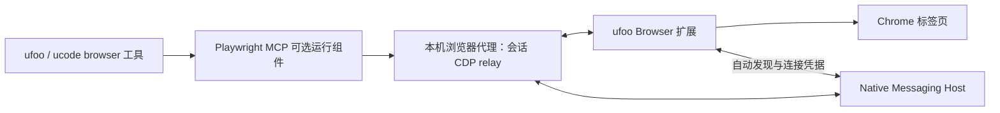

# ufoo Browser 可选安装方案

> Archived implementation record (2026-11-17). The implemented scope is retained for history; current behavior and supported limits are documented in [README](../../README.md) and [PROJECT](../PROJECT.md). Optional or future items below are not completion claims.

日期：2026-11-16
状态：历史设计方案；4.0.8 已加入可选浏览器扩展，实际能力与命令以 README 和源码为准。
首版范围：macOS + 日常 Chrome，覆盖 ufoo 原生主 Agent、可写原生子任务和 ucode。

## 1. 产品目标

在 ufoo 的安装配置流程中增加 **ufoo Browser（可选）**。用户选择安装并启用后，扩展自动连接本机 ufoo，Agent 可以使用已登录的网页。

用户不需要 API key、不复制连接 token、不填写 CDP 地址，也不需要在每个会话开始时打开配对页或选择授权标签页。安装时选择启用浏览器能力，后续任务范围由用户给 Agent 的指令决定；连接本身不再增加确认步骤。

Chrome 自身的扩展安装确认、权限提示及调试提示不属于 ufoo 的配对流程。正式安装仍遵循 Chrome 的分发方式，不能承诺通过 npm 静默安装扩展或隐藏浏览器提示。[Chrome 安装说明](https://developer.chrome.com/docs/extensions/how-to/distribute/install-extensions)、[调试权限](https://developer.chrome.com/docs/extensions/reference/api/debugger)

## 2. 当前基础与差距

当前已经实现：

- `src/agents/capabilities/browser/`：稳定的 `browser` 工具入口，按需发现 Playwright 操作说明。
- `src/runtime/browser/playwrightSession.js`：官方 Playwright MCP 连接、会话隔离、取消、截图和长文本结果；支持官方扩展或显式 CDP 地址。
- 官方 Playwright MCP 固定为 `0.0.85`；真实临时 Chrome 已验证登录状态复用、DOM/坐标操作和非破坏性断开。
- 当前默认连接依赖用户自行安装官方扩展；尚无 ufoo 自有扩展、可选安装向导或自动连接机制。
- 浏览器依赖目前在主包 `dependencies` 中，工具也默认装配；要实现真正可选，需要调整依赖安装和宿主配置，不能只加一个菜单。
- `scripts/postinstall.js` 当前负责二进制执行权限和技能安装；`src/app/cli/features/init.js` 负责项目 context/bus 初始化。浏览器安装属于用户级组件，不应混入每个项目的 `ufoo init`。

此次保留已有浏览器工具接口，增加可选组件管理及自有扩展连接后端，不重写 Playwright 的定位、等待和截图能力。

## 3. 安装时的选择

安装向导增加以下选项，默认不勾选：

```text
选择可选组件

[ ] ufoo Browser
    让 ufoo / ucode 操作日常 Chrome 中已登录的网页。
    启用后自动连接本机 ufoo，无需填写 key 或逐次确认连接。

继续
```

选择安装：安装浏览器运行组件 → 注册本机连接程序 → 引导完成 Chrome 扩展安装 → 自动检测连接 → 显示结果。

选择跳过：完成 ufoo 安装，不下载浏览器运行组件、不注册连接程序、不修改 Chrome；保存跳过选择，不在每次启动时重新询问。

### 3.1 安装入口

建议将完整安装流程明确为以下两个阶段，第二阶段属于安装向导：

```bash
npm install -g u-foo
ufoo setup
```

`ufoo setup` 为拟新增命令。后续若提供独立安装器，由安装器在主包安装成功后自动调用同一套向导，不维护另一套安装逻辑。

不能把必答问题放进 npm `postinstall`：npm 生命周期脚本的终端与输出行为不可靠，也存在 CI、管道和 `--ignore-scripts` 场景。`postinstall` 只负责现有必要处理及尽力展示 `ufoo setup` 提示；用户不应因没有回答浏览器选项而卡住 npm 安装。[npm 生命周期脚本说明](https://docs.npmjs.com/cli/v11/using-npm/scripts/)

仅运行 npm 安装的用户，在第一次启动交互式 `ufoo` / `ucode` 时、进入 TUI 前补充一次同样的组件选择。只在前台交互终端触发；daemon、内部 worker、MCP stdio、`--help`、`--version`、机器可读命令及管道输入均不弹出向导。多进程同时首次启动时，由用户级配置锁保证只有一个入口询问。

### 3.2 拟新增命令

| 命令 | 作用 |
| --- | --- |
| `ufoo setup` | 交互式安装配置，选择是否启用浏览器组件 |
| `ufoo setup --browser=install` | 明确选择安装；允许仍需用户完成 Chrome 安装确认 |
| `ufoo setup --browser=skip` | 明确跳过浏览器组件 |
| `ufoo browser install` | 安装时跳过后，随时补装；重复运行可继续未完成步骤 |
| `ufoo browser status --json` | 查询组件、扩展、协议兼容和连接状态 |
| `ufoo browser doctor` | 检测具体故障并给出下一步处理方式 |
| `ufoo browser enable / disable` | 启用或暂停能力；不删除扩展和登录状态 |
| `ufoo browser update` | 更新可选运行组件并检查扩展兼容性 |
| `ufoo browser uninstall` | 撤销连接并移除本机组件；引导用户从 Chrome 移除扩展 |

非交互安装默认跳过，不把通用 `--yes` 解释为同意启用浏览器。显式请求安装但无法完成 Chrome 确认时，返回 `pending_browser_install`，保留已完成步骤；不能把“组件下载成功”显示成“浏览器已可用”。

### 3.3 Chrome 中实际安装什么

- 正式版：发布独立的 **ufoo Browser** 商店条目，向导打开该条目，用户完成 Chrome 自身的安装确认。随后自动连接，无需第二次配对授权。
- 开发版：提供固定开发扩展 ID 的构建产物，引导开发者通过“加载已解压的扩展程序”安装。该流程单独标注为开发模式，不作为普通用户的开箱体验。
- 商店尚未发布前，正式安装器只能显示“暂不可安装”或引导开发预览，不能自动改装官方 Playwright 扩展冒充完成。
- 扩展 ID、版本范围和发布地址来自发布清单；不复用微软扩展 ID、签名或品牌标识。

## 4. 扩展复用与自动连接

基于 Playwright 官方 `packages/extension` 做有限修改，固定上游 commit。保留其 Chrome 调试适配、目标事件转发和多客户端处理；修改品牌界面、连接引导、控制权分配及宿主发现。保留上游许可证和版权声明，并记录修改与协议兼容范围。[扩展源码](https://github.com/microsoft/playwright/tree/main/packages/extension)、[许可证](https://github.com/microsoft/playwright/blob/main/LICENSE)

建议链路：



连接流程：

1. 安装器在用户目录注册 Native Messaging Host，仅允许正式 ufoo 扩展 ID；开发 ID 使用独立的开发配置。
2. 扩展加载后主动连接本机 Host。Host 使用稳定的绝对路径启动，并连接同一 OS 用户的 ufoo 浏览器代理。
3. 代理校验组件版本、扩展 ID、启用状态和协议范围，自动建立连接；用户不操作 token。
4. Host 经原生通道向扩展交付短期连接凭据与本地 relay 地址。网页无法获取这些凭据；它们也不进入模型、项目文件或普通日志。
5. 高频 CDP 消息和大截图沿用本地 WebSocket relay，Native Messaging 只承载发现和控制消息，避免把大图直接塞进有消息大小限制的原生通道。
6. Playwright MCP 使用代理分配的会话 CDP 端点。Agent 侧仍调用现有 `browser` 工具，无需了解扩展连接细节。

Native Messaging Host 是很薄的连接程序，不承担项目路由、模型调用或页面操作逻辑。代理由用户级 daemon 管理，按需启动；独立 ucode 也使用同一个代理，避免每个项目启动自己的浏览器控制服务。[Chrome Native Messaging](https://developer.chrome.com/docs/extensions/develop/concepts/native-messaging)

本地 relay 的身份校验仍然存在，只是全部自动处理；不通过取消校验来实现“免 key”。扩展启用状态仅接受安装器或用户设置修改，模型工具不能自行启用已被关闭的组件。

## 5. 标签页和多 Agent 行为

安装启用后，连接与控制权分配不再弹额外授权页：

- Agent 根据用户任务列出标签页，通过明确的 URL、标题和稳定 tab ID 选择目标；存在业务歧义时才询问用户，而不是每次连接都询问。
- 实际操作时按标签页领取控制权；同一标签页同时只属于一个 Agent 会话。同一会话的操作串行执行。
- 已被其他 Agent 占用时返回 `browser_tab_busy`，附可公开的项目/Agent 名称，不抢占、不重复点击；Agent 可使用自己的新标签页。
- 每个会话的 CDP relay 只暴露其获得控制权的目标。外部 CDP 兼容模式继续保留现有全浏览器独占策略，不能直接套到受代理管理的会话 relay 上。
- 扩展面板显示“已连接本机 ufoo”、当前项目、Agent、控制的标签页及“暂停全部 / 释放此标签页”操作。
- 用户主动释放、关闭标签页或暂停扩展后，旧控制凭据立即失效；Agent 不自动夺回。关闭标签页不会触发重新创建替代页面。
- 浏览器/daemon 意外重启可自动重新建立连接，但旧请求不会重放。重新确认页面身份和当前状态后，才能继续新的操作。
- 没有任务时不全量截图、抓取历史或枚举页面正文。隐身窗口、Chrome 内部页面及其他扩展页面不属于首版支持范围。

“无需逐次连接授权”不改变用户任务范围：发送消息、提交订单等行为仍按现有 Agent 行为规则执行，不另加一套逐点击确认 UI。

## 6. 可选依赖和配置

主包保留轻量能力适配器，把 Playwright/MCP 运行依赖移入用户级可选组件目录，例如：

```text
~/.ufoo/browser/
  install.json                 # 安装选择、状态与组件版本
  runtime/<version>/           # 完整、不可原地修改的运行组件
  active.json                  # 当前生效版本与绝对入口
  native-host/                 # 稳定启动器及注册元数据
  private/                     # 仅宿主可读的连接材料
```

不能仅把依赖改成 npm `optionalDependencies` 来表示“用户未选择时不下载”：它仍可能默认安装。组件管理器应在用户明确选择后下载固定版本构建产物，并校验发布清单与摘要。Playwright 服务进程从该目录启动，主包不依赖其内部 `node_modules` 路径。

拟新增用户级配置，浏览器能力与项目上下文分开：

```json
{
  "browser": {
    "enabled": true,
    "backend": "ufoo-extension",
    "setupChoice": "install",
    "schemaVersion": 1
  }
}
```

- `setupChoice` 为 `unset / install / skip`；安装进度独立保存在 `install.json`，不能用 `enabled=true` 推断安装完成。
- 代理向宿主广播组件状态。已运行的 main/ucode 在安全的轮次边界刷新配置，不强制用户重启整个 daemon 才能发现扩展。
- 为保持模型工具定义稳定，可保留轻量 `browser` 入口；未启用时只提供状态/安装指引，操作在宿主层返回 `browser_disabled`，不加载可选依赖、不启动进程。
- `browser.control` 的实际授权由宿主配置决定；不能因为模型看到了工具说明，就认为它已获浏览器控制权。安装、启用、升级不做成模型可自行调用的浏览器操作。
- 全局路由器、只读子任务继续没有浏览器操作能力；SDK 管理的 Codex/Claude Worker 的浏览器接入另行适配，不宣称自动继承。
- 保留官方扩展和显式 CDP 的高级兼容路径。已有配置继续有效，不自动覆盖；新安装默认使用 ufoo 扩展。

## 7. 状态与故障反馈

| 状态/错误 | 向用户展示 | Agent 行为 |
| --- | --- | --- |
| `not_installed` / `disabled` | 浏览器组件未安装 / 已关闭，可稍后启用 | 返回明确原因；继续不依赖网页的工作 |
| `installing` | 正在准备浏览器组件 | 安装器负责进度，不占用模型轮次轮询 |
| `pending_browser_install` | 本机组件已就绪，请完成 Chrome 扩展安装 | 不把依赖安装成功当成连接成功 |
| `waiting_for_browser` | Chrome 尚未运行或扩展已停用 | 等待连接事件，不反复发起同一失败请求 |
| `ready` | 已连接，可以使用 | 按任务选择页面并领取控制权 |
| `browser_tab_busy` | 此页面正在由另一个 Agent 使用 | 不抢占；等待释放或改用其他标签页 |
| `protocol_mismatch` | 扩展与本机组件版本不兼容 | 显示需要更新的组件，不循环重连 |
| `browser_action_uncertain` | 连接中断，最后操作结果尚未确认 | 检查页面结果；不自动重放提交/点击 |

状态变化由工具返回与 TUI 展示共同表达。缺少连接条件时，Agent 不应直接宣称“只能上传截图”；应先说明具体缺失条件、可用连接方式，以及可继续完成的任务。

## 8. 升级、卸载与分发

- 可选组件下载到临时版本目录，校验并完成模块自检后，原子更新 `active.json`；失败保留旧版本。
- 正在运行的浏览器连接继续使用旧版本入口，新连接使用新版本；等旧连接退出后再清理旧目录。
- 不在用户正在运行的 ufoo 源码目录或全局链接包中执行依赖更新，避免再次出现 `undici` 等依赖被安装过程短暂移走的故障。
- 扩展经 Chrome 商店独立更新，本机组件维护明确兼容范围；协议版本不兼容时停止接管，不强行继续执行。
- Native Host 注册指向稳定启动器，不直接指向某个 npm 包版本。检测 Node 可执行文件失效时由 doctor 修复路径，不能依赖 Chrome 启动环境的 shell PATH。
- 卸载先撤销会话和自动连接凭据，再删除 ufoo 自有 Host 注册和可选组件。不退出 Chrome、不删除用户标签页、历史、cookie 或其他扩展。
- Chrome 扩展由用户在浏览器中移除；仅卸载主 npm 包时，残留扩展显示“本机 ufoo 未安装”，不继续重连刷日志。
- 保留“跳过”选择。软件升级不重新弹出浏览器安装问题，也不把曾拒绝的功能默认打开。

## 9. 源码落点

以下为拟新增或调整的位置，具体文件名可在实现时细化：

| 位置 | 职责 |
| --- | --- |
| `extensions/ufoo-browser/` | 上游扩展 fork、面板、manifest、构建说明与修改记录 |
| `src/app/cli/setupCommands.js` | 安装向导、非交互参数和一次性选择 |
| `src/app/cli/browserCommands.js` | install/status/doctor/enable/disable/update/uninstall |
| `src/runtime/browser/` | 组件安装器、Native Host、自动连接、会话代理、协议适配 |
| `src/agents/capabilities/browser/` | 保持现有工具接口，接入组件状态及新的连接后端 |
| `src/runtime/daemon/` | 用户级浏览器代理生命周期、配置通知与项目隔离 |
| `src/code/launcher/` | 独立 ucode 首次交互安装入口、浏览器状态发现 |
| `scripts/postinstall.js` | 不阻塞的 setup 提示，不承担浏览器权限确认 |
| `package.json` / 发布工作流 | 拆分可选运行组件，生成固定版本与兼容性清单 |
| `README.md` / `PROJECT.md` | 安装说明、源码地图、能力边界和开发验收入口 |

浏览器和安装实现不进入 `src/agents/runtime/core/`。新增扩展源码目录需要同步公开源码地图；不使用被忽略的 `docs/` 作为方案或实现真相源。

## 10. 实施顺序与验收

| 阶段 | 交付物 | 通过条件 |
| --- | --- | --- |
| A：可选组件安装 | setup 选择、安装状态、独立运行目录、doctor | 安装/跳过均幂等；CI 不等待输入；失败不影响基础 ufoo 启动 |
| B：扩展 fork 与自动连接 | 开发扩展、Native Host、固定协议 relay | 安装启用后无需 token、配对页或逐次授权；使用日常浏览器现有登录态 |
| C：宿主与多 Agent | main/ucode 共用代理、控制权、状态通知 | 两个 Agent 操作不同页面互不干扰；同页不会互相覆盖输入；暂停立即生效 |
| D：发布与升级 | 商店条目、组件发布清单、升级/卸载路径 | 新用户能从安装选项完成全流程；旧会话不因升级被中断或重复执行 |

关键回归与手动验收：

1. 首次安装选择跳过，不下载 Playwright、不创建 Host、不碰 Chrome；再次启动不重复询问。
2. 后续补装可成功；没有 Chrome、离线、安装中断和商店未发布均给出准确状态。
3. 安装启用后的首次使用、第二个会话、浏览器重启、daemon 重启均不要求手填 key 或额外连接授权。
4. 连接身份错误、扩展 ID 不匹配、网页伪造连接、过期连接凭据均被拒绝。
5. 已登录页面的读取、输入、点击、截图、坐标拖动、iframe 和导航后继续操作均通过真实 Chrome 验证。
6. 多项目/多 Agent 并发，用户切换/关闭标签页、打开 DevTools、暂停扩展时控制权与状态正确。
7. 提交后断线、取消与进程崩溃不重复执行操作；自动重连不等于自动重放。
8. 长页面内容可回读、截图正确进入模型图像通道；浏览器状态变化不改写系统提示前缀。
9. 可选组件升级期间持续启动普通 ufoo 命令，不出现运行依赖缺失；失败升级可回退。
10. 卸载不改变浏览器登录状态、不关闭已有页面；不支持的浏览器/平台不误报成功。

完成标准：用户从安装向导勾选 ufoo Browser，并完成 Chrome 自身的安装确认后，可以直接说“查看我打开的页面”；全流程没有复制 key、填写端口、单独配对或逐会话授权步骤。
